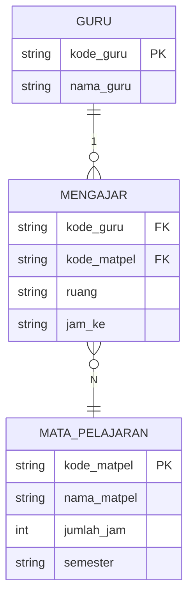

# Tugas Basis Data: Pembuatan ERD Relasi One to Many (1 : N)

**Mata Pelajaran:** Pemodelan Perangkat Lunak / Basis Data (RPL Kelas XI)  
**Referensi:** Buku *Rekayasa Perangkat Lunak Jilid 1 untuk SMK/MAK Kelas XI*, Ali Aljauhari (2023), Hal. 22, Gambar 1.22  
## 1. Dekomposisi Komponen ERD

### A. Entitas & Atribut
1. **Entitas: Guru**
   - Simbol: Persegi Panjang
   - Atribut:
     - `Kode_guru` (Primary Key / Kunci Utama)
     - `Nama_guru` (Atribut Deskriptif)

2. **Entitas: Mata Pelajaran**
   - Simbol: Persegi Panjang
   - Atribut:
     - `Kode_matpel` (Primary Key / Kunci Utama)
     - `Nama_matpel`
     - `Jumlah_jam`
     - `Semester`

### B. Relasi & Atribut Relasi
- **Nama Relasi:** `Mengajar`
- **Simbol:** Belah Ketupat (Diamond)
- **Atribut Relasi:**
  - `Kode_guru` (Foreign Key mengacu ke Guru)
  - `Kode_matpel` (Foreign Key mengacu ke Mata Pelajaran)
  - `Ruang` (Tempat KBM berlangsung)
  - `Jam_ke` (Alokasi jam pertemuan/sesi mengajar)

---

## 2. Diagram ERD (Mermaid)



---

## 3. Transformasi ke Skema Relasional (Tabel Database)

### 1. Tabel `guru`
| Field | Tipe Data | Keterangan |
|---|---|---|
| `kode_guru` | VARCHAR(10) | **PRIMARY KEY** |
| `nama_guru` | VARCHAR(100) | NOT NULL |

### 2. Tabel `mata_pelajaran`
| Field | Tipe Data | Keterangan |
|---|---|---|
| `kode_matpel` | VARCHAR(10) | **PRIMARY KEY** |
| `nama_matpel` | VARCHAR(100) | NOT NULL |
| `jumlah_jam` | INT | NOT NULL |
| `semester` | ENUM('Ganjil', 'Genap') | NOT NULL |

### 3. Tabel `mengajar` (Tabel Relasi Jadwal)
| Field | Tipe Data | Keterangan |
|---|---|---|
| `id_mengajar` | INT (Auto Increment) | **PRIMARY KEY** |
| `kode_guru` | VARCHAR(10) | **FOREIGN KEY** (references `guru.kode_guru`) |
| `kode_matpel` | VARCHAR(10) | **FOREIGN KEY** (references `mata_pelajaran.kode_matpel`) |
| `ruang` | VARCHAR(20) | NOT NULL |
| `jam_ke` | VARCHAR(20) | NOT NULL |

---

## 5. Sintaks SQL (DDL & DML)

File skrip siap pakai tersimpan di [`schema.sql`](file:///c:/Users/rplha/OneDrive/Desktop/SY2024/schema.sql).

```sql
-- 1. Membuat Database
CREATE DATABASE IF NOT EXISTS db_sekolah;
USE db_sekolah;

-- 2. Membuat Tabel Guru
CREATE TABLE guru (
    kode_guru VARCHAR(10) PRIMARY KEY,
    nama_guru VARCHAR(100) NOT NULL
);

-- 3. Membuat Tabel Mata Pelajaran
CREATE TABLE mata_pelajaran (
    kode_matpel VARCHAR(10) PRIMARY KEY,
    nama_matpel VARCHAR(100) NOT NULL,
    jumlah_jam INT NOT NULL,
    semester ENUM('Ganjil', 'Genap') NOT NULL
);

-- 4. Membuat Tabel Relasi Mengajar
CREATE TABLE mengajar (
    id_mengajar INT AUTO_INCREMENT PRIMARY KEY,
    kode_guru VARCHAR(10) NOT NULL,
    kode_matpel VARCHAR(10) NOT NULL,
    ruang VARCHAR(20) NOT NULL,
    jam_ke VARCHAR(20) NOT NULL,
    FOREIGN KEY (kode_guru) REFERENCES guru(kode_guru) ON DELETE CASCADE,
    FOREIGN KEY (kode_matpel) REFERENCES mata_pelajaran(kode_matpel) ON DELETE CASCADE
);

-- 5. Contoh Data Dummy
INSERT INTO guru (kode_guru, nama_guru) VALUES
('G001', 'Budi Santoso, S.Kom.'),
('G002', 'Siti Rahmawati, S.Pd.');

INSERT INTO mata_pelajaran (kode_matpel, nama_matpel, jumlah_jam, semester) VALUES
('MP01', 'Pemodelan Perangkat Lunak', 4, 'Ganjil'),
('MP02', 'Basis Data', 4, 'Ganjil'),
('MP03', 'Pemrograman Web', 6, 'Genap');

INSERT INTO mengajar (kode_guru, kode_matpel, ruang, jam_ke) VALUES
('G001', 'MP01', 'Lab RPL 1', '1 - 4'),
('G001', 'MP02', 'Lab RPL 2', '5 - 8'),
('G002', 'MP03', 'Lab RPL 1', '1 - 6');

-- 6. Menampilkan Hasil dengan JOIN
SELECT 
    g.kode_guru,
    g.nama_guru,
    mp.nama_matpel,
    mp.jumlah_jam,
    m.ruang,
    m.jam_ke
FROM mengajar m
JOIN guru g ON m.kode_guru = g.kode_guru
JOIN mata_pelajaran mp ON m.kode_matpel = mp.kode_matpel;
```

---

## 6. Berkas Proyek di Direktori

- [`schema.sql`](file:///c:/Users/rplha/OneDrive/Desktop/SY2024/erd/schema.sql) : Skrip SQL untuk phpMyAdmin / MySQL.
- [`LAPORAN_ERD.md`](file:///c:/Users/rplha/OneDrive/Desktop/SY2024/erd/LAPORAN_ERD.md) : Dokumentasi ERD
